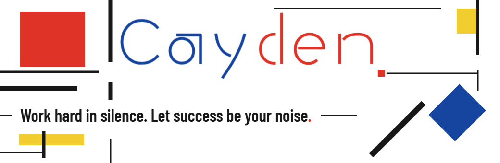

<strong>中文</strong> · <a href="./README.en.md">English</a>

## 一点关于我

对一切未知的事物充满好奇

## 一些作品

<picture>
  <source media="(max-width: 767px)" srcset="./assets/body-yellow-plane-small.svg">
  
</picture>

### [RAG](https://github.com/CaydenZheng/RAG)

让本地知识可检索，让 Agent 能动手。混合检索、MCP 工具接入与流式回答。

### [MindTrace · 日迹](https://github.com/CaydenZheng/mindtrace-web)

你写下思考，AI 做你的镜子。本地优先的随记与自我洞察工具。

### [SASRec](https://github.com/CaydenZheng/sasrec)

复现 SASRec 序列推荐模型，用自注意力捕捉行为序列，预测下一次交互。

  <a href="https://github.com/CaydenZheng?tab=repositories">全部仓库 →</a>
  

